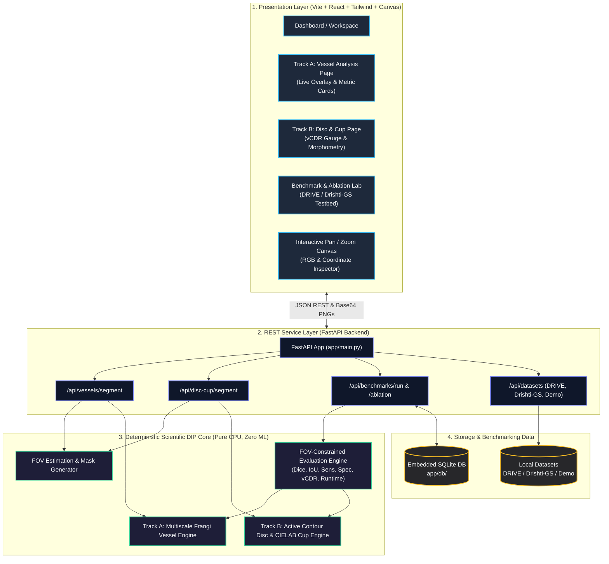
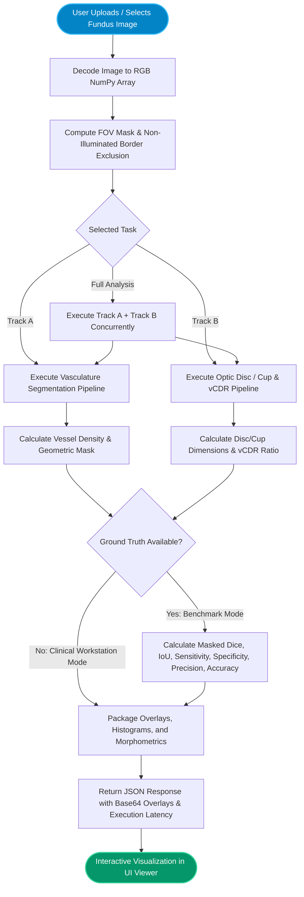
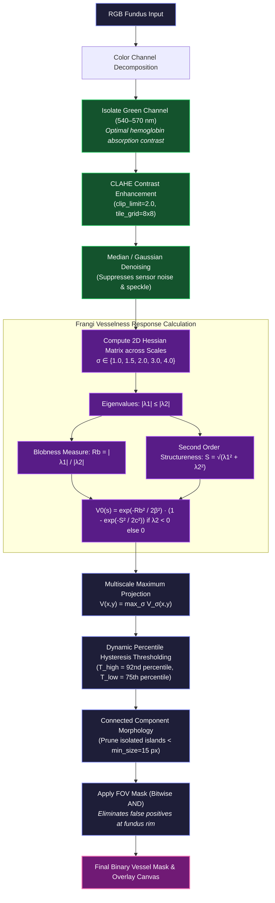
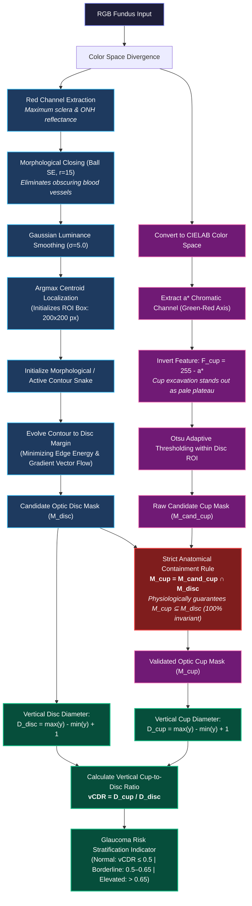

# OptiFilter / MorphoVision — Complete Visual System Flowchart

This document provides visual flowcharts mapping the architecture, end-to-end dataflow, and algorithms of **OptiFilter (MorphoVision)**: a deterministic, classical Digital Image Processing (DIP) retinal fundus analysis workstation.

---

## 1. High-Level System Architecture & Flow

---

## 2. End-to-End Operational Execution Flow

---

## 3. Track A Deep Dive: Retinal Vessel Segmentation

---

## 4. Track B Deep Dive: Optic Disc & Cup Segmentation (vCDR)

---

## 5. Benchmarking & Ablation Engine Flowchart

---

## 6. Key Algorithmic Formulations Summary

| Stage | Mathematical Basis | Primary Operational Role |
| :--- | :--- | :--- |
| **FOV Extraction** | $I_{gray} > \theta_{fov} \rightarrow \mathcal{M}_{fov}$ | Excludes black boundary from skewing specificity & accuracy |
| **Vasculature Contrast** | $\text{CLAHE}(I_G, \text{clip}=2.0, \text{grid}=(8,8))$ | Enhances microcapillaries against retinal pigment variation |
| **Frangi Eigenanalysis** | $\mathcal{H} = \begin{bmatrix} I_{xx} & I_{xy} \\ I_{yx} & I_{yy} \end{bmatrix}, \lambda_1, \lambda_2$ | Discriminates tubular vessels from non-tubular exudates/lesions |
| **Disc Localization** | $R_{close} = (I_R \bullet B)_{r=15}$, $(x_0, y_0) = \arg\max(G_\sigma * R_{close})$ | Robust optic nerve head centroid detection unaffected by vessel trunks |
| **Cup Extraction** | $F_{cup} = 255 - a^*$, $\mathcal{M}_{cand\_cup} = \text{Otsu}(F_{cup})$ | Exploits physiological absence of blood vessels in physiological cup |
| **Strict Containment** | $\mathcal{M}_{cup} = \mathcal{M}_{cand\_cup} \cap \mathcal{M}_{disc}$ | Prevents cup leakage into peripapillary atrophy (PPA) regions |
| **Vertical CDR** | $\text{vCDR} = \frac{\max_{cup} y - \min_{cup} y + 1}{\max_{disc} y - \min_{disc} y + 1}$ | Standard quantitative ophthalmic biomarker for cup enlargement |
